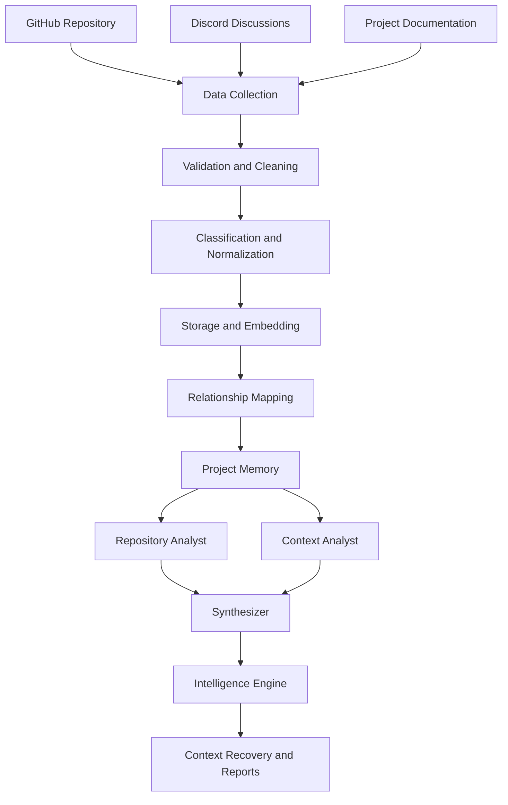

<div align="center">

# RepoBloom

### LOST CONTEXT RECOVERY ENGINE

**Understand what happened. Discover why. Know what comes next.**

[](https://python.org)
[](https://flask.palletsprojects.com/)
[](https://postgresql.org)
[](#the-ai-engine)
[](#testing)

<br>


<br>

[Explore Repository](https://github.com/priyanshukumarverma091-hub/repobloom)

</div>

---

## Overview

Software projects generate knowledge across multiple platforms.

Code lives in repositories. Decisions happen in discussions. Technical explanations are written in documentation. Bugs and unfinished tasks are tracked separately.

Over time, this information becomes fragmented.

RepoBloom is an AI-powered developer intelligence platform designed to bring this information together, connect related events, and recover the context behind software development.

It helps developers understand:

- What happened in a project?
- Why were particular decisions made?
- Which changes are connected to specific issues?
- What problems remain unresolved?
- What should the development team work on next?

**RepoBloom is not simply another AI coding assistant. It focuses on recovering and preserving project context.**

## Core Capabilities

| Capability | Description |
|---|---|
| Multi-source collection | Collects information from GitHub, Discord and documentation. |
| Project intelligence | Analyzes repository activity, architecture, bugs and decisions. |
| Knowledge graph | Connects commits, issues, discussions and files. |
| Project memory | Maintains versioned architecture, development and task knowledge. |
| Context recovery | Reconstructs relevant project history and unfinished work. |
| Evidence-based analysis | Separates verified facts from AI inferences and recommendations. |
| Graceful degradation | Provides computed information even when AI services are unavailable. |

## System Architecture



## The AI Engine

RepoBloom uses three specialized AI model roles.

### 1. Repository Analyst

Responsible for analyzing repository information, including:

- Repository structure
- Source code
- Commits and branches
- Pull requests and reviews
- Issues and contributors
- File relationships

### 2. Context Analyst

Responsible for recovering relevant information from:

- Project documentation
- Discord discussions
- Technical explanations
- Historical decisions
- Development conversations

### 3. Synthesizer

Combines the outputs of both analysts into structured project intelligence.

The model router in `ai/model_router.py` controls execution.

For context recovery and task analysis, the Repository Analyst and Context Analyst execute concurrently using `asyncio.gather`. The Synthesizer runs only when both operations succeed.

The system also supports retries, error handling, partial results and token-cost tracking.

## Data Processing Pipeline

RepoBloom follows a structured processing pipeline:

```text
COLLECT
   |
VALIDATE
   |
CLEAN AND REDACT SECRETS
   |
DUPLICATE DETECTION
   |
CLASSIFICATION
   |
METADATA EXTRACTION
   |
NORMALIZATION
   |
EMBEDDING
   |
STORAGE
   |
RELATIONSHIP MAPPING
   |
PROJECT MEMORY
   |
INTELLIGENCE GENERATION
```

Each collected record retains relevant provenance information:

- Original source
- Timestamp
- Project identifier
- Category
- Original URL
- Permission and licence metadata

This allows generated insights to be traced back to their original information sources.

## Knowledge Graph

RepoBloom uses a graph-oriented relationship model through a `GraphStore` interface.

Examples of relationships:

```text
Bug Issue
    |
    v
Discussion
    |
    v
Technical Decision

Commit ---- resolves ----> Issue

Commit ---- modifies ---> File
```

Explicit references are treated as verified relationships. Relationships inferred from file and time-window similarity are stored separately as inferred relationships.

This distinction helps prevent assumptions from being presented as confirmed facts.

## Project Memory

RepoBloom organizes project knowledge into five categories:

| Memory Category | Purpose |
|---|---|
| Architecture | System components and their relationships |
| Development | Changes and implementation history |
| Decisions | Technical choices and their context |
| Problems | Bugs and unresolved issues |
| Tasks | Pending work and recovered next steps |

Memory updates are versioned.

Identical restatements add provenance instead of creating unnecessary duplicates. Changed statements create new versions, preserving the previous information. Potentially risky changes are flagged for review.

## Anti-Fabrication and Security

Trustworthiness is an important part of RepoBloom's design.

### Evidence-based AI output

A model-generated fact must reference evidence identifiers, such as `R12`, that were actually provided to the model.

Unsupported claims are demoted to low-confidence inferences.

### Prompt-injection protection

External content is treated as untrusted input.

The processing layer includes:

- Untrusted-content fencing
- Closing-tag neutralization
- Suspicious-content flagging
- Secret and email redaction before storage

These measures are intended to reduce risks from malicious or misleading external content.

## Technology Stack

| Component | Technologies |
|---|---|
| Backend | Python, Flask |
| AI integration | OpenRouter |
| Agent execution | Asyncio |
| Repository integration | GitHub REST API, GitPython |
| Discussion integration | Discord Bot API |
| Documentation extraction | Trafilatura, BeautifulSoup |
| HTTP client | HTTPX |
| Database | SQLite, PostgreSQL |
| Vector representation | Local lexical hashing, 256 dimensions |
| Testing | Pytest |
| Deployment | Render |

## IBM Bob Development Contribution

RepoBloom's development process was supported by **IBM Bob**, an AI-powered coding companion.

IBM Bob was used as a development assistant for working through complex implementation requirements.

Its assistance included:

- Breaking larger development requirements into manageable tasks.
- Exploring implementation approaches for the multi-agent architecture.
- Working through model-routing and backend integration challenges.
- Debugging errors and understanding unexpected application behaviour.
- Reviewing code structure and improving implementation clarity.
- Considering edge cases involving incomplete repository information and inconsistent AI responses.

The development workflow involved reviewing suggestions, testing changes and evaluating implementation decisions rather than blindly accepting generated code.

IBM Bob supported the engineering workflow while the project's architecture, implementation and validation remained part of the development work.

## Run Locally

RepoBloom includes a demo mode that can be explored without configuring AI API keys.

### Requirements

- Python 3.10 or later
- pip

### 1. Clone the repository

```bash
git clone https://github.com/priyanshukumarverma091-hub/repobloom.git
cd repobloom
```

### 2. Create a virtual environment

**Windows PowerShell**

```powershell
python -m venv .venv
.venv\Scripts\activate
```

**Linux / macOS**

```bash
python -m venv .venv
source .venv/bin/activate
```

### 3. Install dependencies

```bash
pip install -r requirements.txt
```

### 4. Start the application

```bash
python app.py
```

Open the following address:

```text
http://127.0.0.1:5000
```

Select **Load demo project** to explore the application.

The demo uses local SQLite storage. Without AI credentials, computed verified facts remain available and the application clearly indicates that AI functionality is disabled.

## Configure AI Services

Create a `.env` file using `.env.example`.

```env
DATABASE_URL=

OPENROUTER_API_KEY=

REPO_ANALYST_MODEL=
CONTEXT_ANALYST_MODEL=
SYNTHESIZER_MODEL=

GITHUB_TOKEN=
DISCORD_BOT_TOKEN=

APP_ACCESS_TOKEN=
```

| Variable | Purpose |
|---|---|
| `DATABASE_URL` | PostgreSQL database connection |
| `OPENROUTER_API_KEY` | OpenRouter authentication |
| `REPO_ANALYST_MODEL` | Repository Analyst model |
| `CONTEXT_ANALYST_MODEL` | Context Analyst model |
| `SYNTHESIZER_MODEL` | Synthesizer model |
| `GITHUB_TOKEN` | Private repository access and higher API limits |
| `DISCORD_BOT_TOKEN` | Discord integration |
| `APP_ACCESS_TOKEN` | Optional API access protection |

The three AI roles can use different OpenRouter model IDs.

Never commit `.env` files or expose API credentials in the repository.

## Discord Integration

To enable Discord collection:

1. Create a bot through the Discord Developer Portal.
2. Enable the privileged Message Content Intent.
3. Invite the bot to your server with appropriate read permissions.
4. Configure `DISCORD_BOT_TOKEN`.
5. Add only the channel IDs you are authorized to analyze.

Author pseudonymization is supported through:

```env
DISCORD_ANONYMIZE=true
```

## Deployment

RepoBloom supports deployment through Render using the included `render.yaml` Blueprint.

The configuration defines:

- Web service
- PostgreSQL database

Deployment process:

1. Push the repository to GitHub.
2. Create a Blueprint on Render.
3. Connect the RepoBloom repository.
4. Configure required environment variables.
5. Deploy the application.

The application includes a 180-second Gunicorn timeout for longer AI operations.

## Testing

RepoBloom currently includes 31 tests covering:

- Data collectors
- Mocked HTTP and Git operations
- Processing pipeline
- AI integration
- Project memory
- Knowledge graph
- API endpoints

Run the test suite:

```bash
pytest
```

## Project Structure

```text
RepoBloom/
|
|-- ai/                 # AI providers and model routing
|-- collectors/         # GitHub, Discord and documentation
|-- processors/         # Data cleaning and processing
|-- intelligence/       # Intelligence modules
|-- memory/             # Versioned project memory
|-- knowledge_graph/    # Relationship mapping
|-- database/           # Database layer
|-- services/           # Application services
|-- routes/             # API endpoints
|-- templates/          # Frontend templates
|-- static/             # Dashboard assets
|-- tests/              # Automated tests
|
|-- app.py
|-- requirements.txt
|-- render.yaml
|-- .env.example
```

## Current Limitations

RepoBloom is an actively developing project. Its current limitations include:

- Embeddings use a deterministic local lexical hashing model with 256 dimensions, not a neural embedding model.
- Synchronization fetches up to approximately 500 items per resource per run and continues incrementally.
- Discord message collection requires the privileged Message Content Intent.
- Classification is rule-based. Some decision-like statements are identified as keyword matches rather than confirmed decisions.
- AI analysis quality depends on the configured models and available source information.

These limitations distinguish implemented functionality from planned improvements.

## Future Development: BloomCore

BloomCore is the planned custom model for RepoBloom.

**BloomCore has not been trained yet.**

The current AI layer follows a provider-based architecture. This means BloomCore can eventually be integrated as another model provider without changing the core Intelligence Engine.

Planned directions include:

- Custom domain-specific model integration.
- Improved semantic retrieval.
- Advanced relationship discovery.
- Better long-term project memory.
- More accurate context reconstruction.
- Improved analysis across larger software projects.

## Project Vision

RepoBloom aims to make project knowledge persistent, connected and easier to understand.

Instead of manually searching through months of commits, discussions and documentation, developers should be able to recover the information needed to understand and continue their work.

**Code explains what a system does. Context explains how it got there.**

---

<div align="center">

### RepoBloom

**Recover the context. Understand the project. Continue with clarity.**

[GitHub Repository](https://github.com/priyanshukumarverma091-hub/repobloom)

</div>
